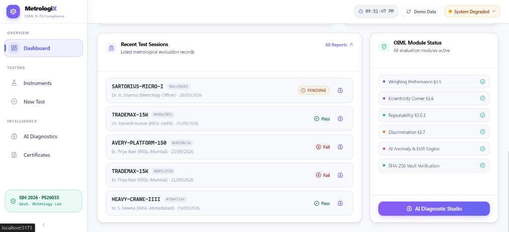
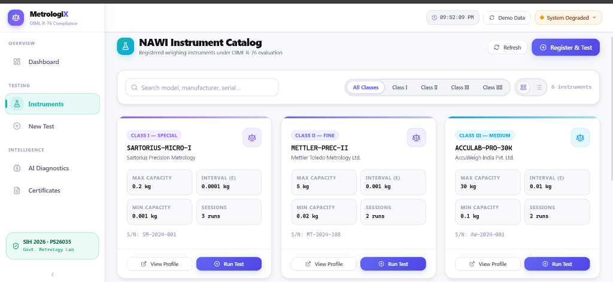
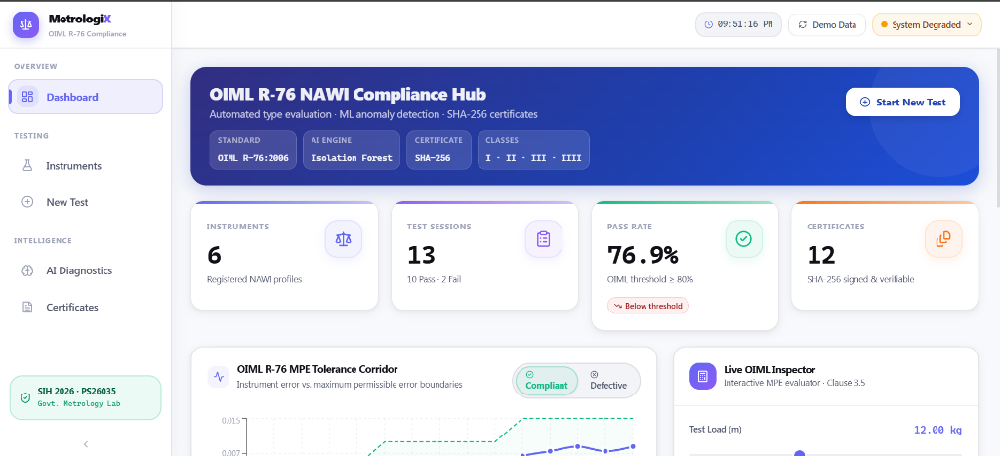
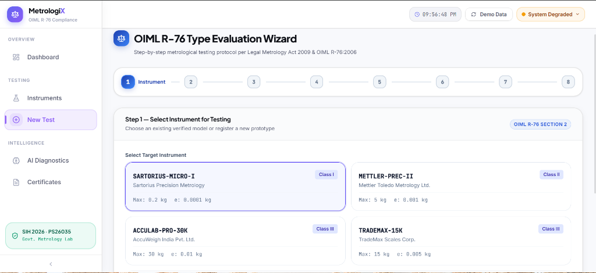
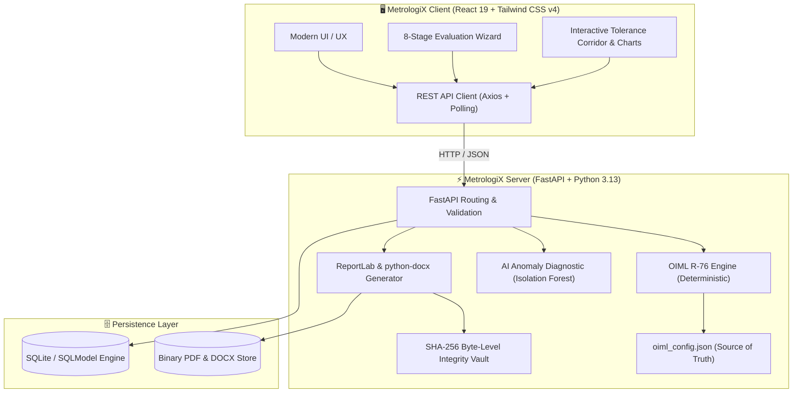

# ⚖️ MetrologiX

<div align="center">


[](https://www.sih.gov.in/)
[](https://www.oiml.org/)
[](https://consumeraffairs.nic.in/)
[](https://fastapi.tiangolo.com/)
[](https://react.dev/)
[](file:///backend/tests/test_oiml_engine.py)
[](LICENSE)

<p align="center">
  <b>Automated Test Report Generation & Evaluation Platform for Non-Automatic Weighing Instruments (NAWIs)</b><br/>
  <i>Engineered for Government Legal Metrology Laboratories, Regional Reference Standard Labs (RRSL), and Verification Officers.</i>
</p>

[Key Features](#-key-features) •
[UI Showcase](#-visual-walkthrough--ui-showcase) •
[Architecture](#-system-architecture) •
[OIML R-76 Testing Protocol](#-oiml-r-76-testing-protocol) •
[Getting Started](#-getting-started) •
[Testing & Verification](#-testing--verification)

---

</div>

## 📸 Visual Walkthrough & UI Showcase

### 1. Executive Dashboard & Tolerance Corridor
> Real-time compliance monitoring, active module tracking, and interactive OIML R-76 §3.5 Maximum Permissible Error (MPE) tolerance corridor visualization.

<div align="center">
  
</div>

<br/>

### 2. NAWI Instrument Catalog (Classes I, II, III, IIII)
> Structured instrument registration conforming to metrological constraints ($Max > Min > 0$, $d \le e$, $n = Max/e$).

<div align="center">
  
</div>

<br/>

### 3. Step-by-Step OIML R-76 Evaluation Wizard
> Automated guided testing across 8 metrological stages with live backend MPE boundaries, tare calibration, discrimination, and repeatability evaluation.

<div align="center">
  
</div>

<br/>

### 4. Recent Test Sessions & Real-Time Module Engine
> Automated test session tracking, deterministic verdict derivation, and instant AI advisory anomaly flags.

<div align="center">
  
</div>

---

## 🌟 Key Features

### ⚖️ Deterministic OIML R-76 Metrological Engine
- **Single Source of Truth**: All MPE thresholds and formula parameters are defined in `backend/oiml_config.json`.
- **Full Accuracy Class Coverage**: Precision evaluation for **Class I** (Special), **Class II** (High), **Class III** (Medium), and **Class IIII** (Ordinary).
- **Physical Validation**: Strict enforcement of $d \le e$, capacity limits $Max > Min > 0$, and scale divisions $n = Max / e$.
- **Advisory AI Separation**: Machine learning anomaly detection operates strictly in an **advisory role**; compliance verdicts are purely derived from deterministic physical metrology rules.

### 🧪 Comprehensive Testing Protocol Suite
1. **Weighing Performance (§3.5)**: Increasing/decreasing load steps with net error calculation $E = I + 0.5d - \Delta L - L$ and $E_c = E - E_0$.
2. **Tare Accuracy (§3.5.3)**: Corrected tare error calculation $E_{tare} = I_t + 0.5d - \Delta L - L_{tare}$.
3. **Eccentricity Corner Load (§3.6)**: 5-point loading at $1/3\,Max$ for standard NAWIs, 4-point loading for rolling instruments, and multi-point support testing.
4. **Repeatability (§3.6.1)**: $\Delta I_{max} \le \text{MPE}$ across 3 test series at $0.5\,Max$ and $1.0\,Max$.
5. **Discrimination Test (§3.7)**: Threshold verification ensuring an extra load of $1.4d$ produces a definite change of $\Delta I \ge 1.0d$.
6. **Creep & Zero Return (§3.9)**: Zero drift and indication stability over 30-minute intervals ensuring $|\Delta I_{30min}| \le 0.5e$.

### 🔒 Cryptographic Certificate Vault
- **Dual Format Generation**: Instant, high-resolution **PDF** (ReportLab) and editable **Word `.docx`** (python-docx) report generation.
- **SHA-256 Digital Fingerprint**: Every generated certificate embeds a cryptographic SHA-256 hash computed over exact binary payload bytes for tamper-proof verification.
- **QR Code Verification**: Instant digital verification via scan for laboratory field inspectors.

---

## 🏗️ System Architecture



---

## 📐 OIML R-76 Testing Protocol

| Standard Clause | Test Description | Evaluation Criteria | Metric / Formula |
| :--- | :--- | :--- | :--- |
| **OIML R-76 §3.5** | Weighing Performance | Indication error within MPE | $E_c = (I + 0.5d - \Delta L - L) - E_0$ |
| **OIML R-76 §3.5.3** | Tare Accuracy | Net weighing accuracy after tare | $E_{tare} = I_t + 0.5d - \Delta L - L_t$ |
| **OIML R-76 §3.6** | Eccentricity Load | Max error across off-center positions | $Max\|E_c\| \le \text{MPE}$ at $1/3\,Max$ |
| **OIML R-76 §3.6.1** | Repeatability | Max spread across identical loads | $(I_{max} - I_{min}) \le \text{MPE}(L)$ |
| **OIML R-76 §3.7** | Discrimination | Indication response to extra load | Extra load $1.4d \implies \Delta I \ge 1.0d$ |
| **OIML R-76 §3.9** | Creep & Zero Drift | Indication stability after 30 min | $\|\Delta I_{30min}\| \le 0.5e$ |

---

## 🚀 Getting Started

### Prerequisites
- **Python 3.11+** (Tested on Python 3.13)
- **Node.js 18+** & `npm`
- **Git**

---

### 1. Clone Repository
```bash
git clone https://github.com/Piyushrai05/MetrologiX.git
cd MetrologiX
```

---

### 2. Backend Setup
```bash
# Navigate to backend
cd backend

# Create virtual environment (optional but recommended)
python -m venv venv
venv\Scripts\activate      # Windows
# source venv/bin/activate  # Linux/macOS

# Install dependencies
pip install -r requirements.txt

# Start backend server
python -m uvicorn main:app --reload --port 8000
```
Backend will be live at: **`http://127.0.0.1:8000`**  
Interactive Swagger docs: **`http://127.0.0.1:8000/docs`**

---

### 3. Frontend Setup
```bash
# In a new terminal, navigate to frontend
cd frontend

# Install dependencies
npm install

# Start Vite dev server
npm run dev
```
Frontend will be live at: **`http://localhost:5173`**

---

## 🧪 Testing & Verification

The deterministic calculation engine is thoroughly verified with an automated unit testing suite covering boundary conditions, step errors, eccentricity, repeatability, discrimination, and creep:

```bash
cd backend
pytest tests/test_oiml_engine.py -v
```

**Test Execution Results:**
```
============================= test session starts =============================
platform win32 -- Python 3.13.5, pytest-9.1.1, pluggy-1.5.0
rootdir: C:\Documents\Desktop\Tech with me\backend
collected 59 items

tests\test_oiml_engine.py ............................................................. [100%]

============================== 59 passed in 0.40s ==============================
```

---

## 📦 Tech Stack

- **Backend Framework**: [FastAPI](https://fastapi.tiangolo.com/) (Asynchronous High-Performance Python Web API)
- **ORM & Database**: [SQLModel](https://sqlmodel.tiangolo.com/) & SQLite
- **Report Generation**: [ReportLab](https://www.reportlab.com/) (PDF Engine) & [python-docx](https://python-docx.readthedocs.io/)
- **Frontend Framework**: [React 19](https://react.dev/) + [TypeScript](https://www.typescriptlang.org/)
- **Build Tool**: [Vite 8](https://vitejs.dev/)
- **Styling**: [Tailwind CSS v4](https://tailwindcss.com/) + Custom Metrology Design Tokens
- **Icons**: [Lucide React](https://lucide.dev/)
- **Visualizations**: [Recharts](https://recharts.org/)

---

## 👥 Smart India Hackathon (SIH) 2026

- **Problem Statement ID**: `PS26035`
- **Theme**: Legal Metrology / Automated NAWI Verification & Type Evaluation
- **Standard**: OIML R-76-1 (2006) / Legal Metrology Act 2009 (India)

---

<div align="center">
  <sub>Developed with precision for SIH 2026 · MetrologiX Metrology Systems</sub>
</div>
